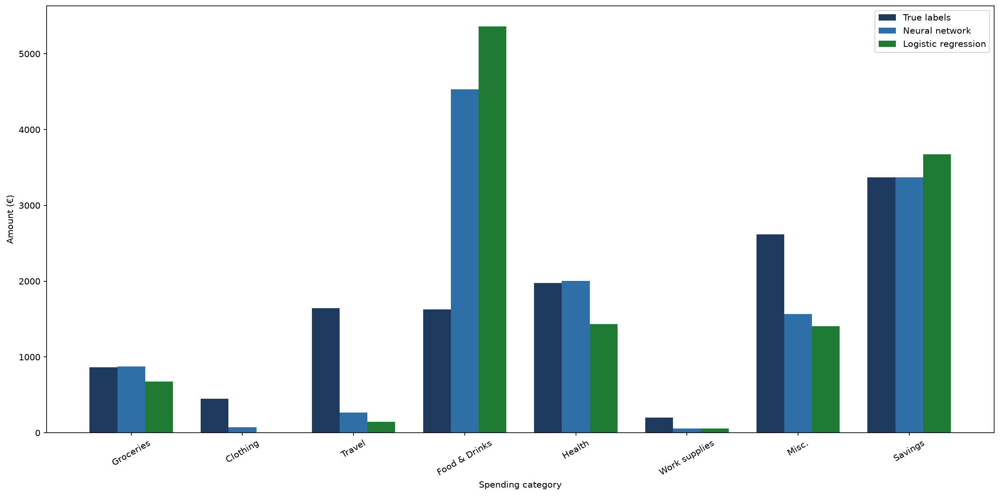
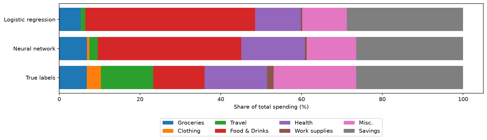

# Personal Finance Transaction Classifier

Machine learning pipeline that automatically categorizes bank transactions from their free-text descriptions. I built it on my own bank export (605 hand-labeled transactions) and compared logistic regression baselines against a small neural network.

**Stack:** Python · pandas · scikit-learn (TF-IDF, logistic regression) · Keras · matplotlib

## Highlights

- **End-to-end project:** raw bank export (702 rows) → cleaning → feature engineering → manual labeling into 8 categories → model training and evaluation → visual comparison.
- **Neural network: 83.6% test accuracy (255/305 transactions)** vs. 75.7% (231/305) for the best logistic regression. Its F1 score is higher in 7 of 8 categories.
- **Counter-intuitive finding:** removing transaction amount and balance *improved* the model (72.5% → 75.7%), because a 25 € payment could belong to almost any category.
- **Error analysis:** weak spots traced to specific causes (merchants never seen in training, a tokenizer that splits "H&M", very small classes) rather than just reported as numbers.

## Motivation

After starting my first salaried job I wanted to know where my money was actually going. Instead of categorizing about a year of transactions by hand, I labeled a sample, trained a model on it, and checked how well it generalizes to the rest of the data. The project doubles as practice in building a classifier on a real, messy dataset, including documenting what does not work.

## Data and preprocessing

The raw export has 702 rows and 10 columns: `Tipo` (type), `Prodotto` (product), `Data di inizio` (start date), `Data di completamento` (completion date), `Descrizione` (description), `Importo` (amount), `Costo` (fee), `Valuta` (currency), `State`, `Saldo` (balance). Column names stay in Italian, as in the source file.

The goal is to classify *outgoing* spending, so I filtered the data as follows:

- **Transaction types:** kept only card payments (`Pagamento con carta`) and transfers (`Pagamento`). Dropped top-ups and interest (income), ATM withdrawals (cash is untraceable), currency exchanges and 3 Revolut payments (all transport-related).
- **Product:** dropped the savings-deposit account.
- **State:** dropped cancelled transactions.
- **Constant or irrelevant columns:** dropped `Valuta` (always EUR), `Costo` (always free) and `Data di completamento`.

Result: **605 transactions** with 5 attributes: type, start date, description, amount, balance.

### Feature engineering

| Feature | Encoding |
|---|---|
| Transaction type | Binary: 1 = transfer, 0 = card payment |
| Start date | Split into day, month and hour (minutes, seconds and year dropped as noise) |
| Description | TF-IDF weights over a vocabulary of the 150 (or 100) most frequent words, using tokens of at least 2 letters |
| Amount, balance | Kept as numeric features in the first experiments, removed later (see below) |

### Labels

I labeled all 605 transactions by hand into 8 categories:

| Target | Category |
|---|---|
| 0 | Groceries (usually supermarket) |
| 1 | Clothing |
| 2 | Travel (fuel, flights) |
| 3 | Food & Drinks (bars, restaurants, breakfast out) |
| 4 | Health (medicines, therapy) |
| 5 | Work supplies |
| 6 | Miscellaneous (anything hard to identify or not covered elsewhere) |
| 7 | Savings (transfers to the savings account) |

Code: [`src/01_data_preparation.py`](src/01_data_preparation.py)

## Experiments

### 1. Logistic regression baselines

I wanted to know how accuracy depends on the amount of training data and on the vocabulary size, so I trained four multiclass logistic regression models. The ratio of features to training examples for each setup:

|  | 150-word vocabulary | 100-word vocabulary |
|---|---|---|
| **300 training examples** | 0.50 | 0.33 |
| **200 training examples** | 0.75 | 0.50 |

Test set: the 305 transactions not used for training (the 200-example set is a subset of the 300-example one).

| Model | Train accuracy | Test accuracy |
|---|---|---|
| 300 examples / 150 words | 0.783 | **0.725** |
| 200 examples / 150 words | 0.785 | 0.633 |
| 300 examples / 100 words | 0.750 | 0.698 |
| 200 examples / 100 words | 0.780 | 0.669 |

- 300 examples / 150 words is the best model, as expected.
- Surprisingly, the worst one is 200 examples / 150 words, not 200 / 100: with few examples and a large vocabulary the model overfits more. The best model classifies about 8 more transactions correctly than 300/100 and about 17 more than 200/100.
- With randomly sampled training sets, having more examples matters mostly because it captures rarer merchants.

Code: [`src/02_logistic_regression.py`](src/02_logistic_regression.py)

### 2. Which features actually help?

The weakest class was **Savings**: about 10 transactions share the identical description "A EUR Emergenza", yet only about half were recognized. What differs between them is amount, balance and time. I had kept those features on the assumption that they carry signal (e.g. low balance → fewer bar expenses), but they turned out to be poor predictors: a 25 € payment can be groceries, a drink, clothing, medicine or anything else.

I retrained model 1 on the text features only:

| | Before (with amount, balance, date) | After (words only) |
|---|---|---|
| Train accuracy | 0.783 | 0.810 |
| Test accuracy | 0.725 | **0.757** |

The F1 score improves in 5 of 8 categories (it gets worse for Groceries, Clothing and Food & Drinks).

**Why Clothing stays so hard:** there are only 21 clothing transactions (11 train, 10 test), and just 3 of the 10 test descriptions also appear in training, so recall cannot exceed 0.3. One of the test merchants is H&M, which the tokenizer splits into "H" and "M" and then discards (words under 2 letters), so only 2 test transactions are recognizable. When unsure, the model falls back on Miscellaneous.

### 3. Neural network

Same inputs as the text-only logistic regression: a fully connected network with layers 150 → 50 → 25 → 15 → 8, ReLU activations, softmax output, sparse categorical cross-entropy, Keras default optimizer, 700 epochs.

| Model | Test accuracy |
|---|---|
| Logistic regression (words only) | 0.757 |
| Neural network | **0.836** |

Code: [`src/03_neural_network.py`](src/03_neural_network.py)

## Results

Per-class comparison on the 305 test transactions (words-only logistic regression vs. neural network):

| Class | Precision LR | Precision NN | Recall LR | Recall NN | F1 LR | F1 NN |
|---|---|---|---|---|---|---|
| 0 Groceries | 1.000 | 0.966 | 0.710 | 0.919 | 0.830 | 0.942 |
| 1 Clothing | 0.000 | 0.667 | 0.000 | 0.200 | 0.000 | 0.308 |
| 2 Travel | 1.000 | 1.000 | 0.583 | 0.750 | 0.737 | 0.857 |
| 3 Food & Drinks | 0.617 | 0.755 | 0.991 | 0.949 | 0.761 | 0.841 |
| 4 Health | 0.950 | 0.889 | 0.679 | 0.857 | 0.792 | 0.873 |
| 5 Work supplies | 1.000 | 1.000 | 0.429 | 0.571 | 0.600 | 0.727 |
| 6 Miscellaneous | 0.968 | 0.800 | 0.638 | 0.681 | 0.769 | 0.736 |
| 7 Savings | 1.000 | 1.000 | 0.667 | 1.000 | 0.800 | 1.000 |

<details>
<summary>Per-class metrics for the four baseline models (300/150, 200/150, 300/100, 200/100)</summary>

**Precision**

| Class | 300 / 150 | 200 / 150 | 300 / 100 | 200 / 100 |
|---|---|---|---|---|
| 0 Groceries | 1.000 | 0.864 | 1.000 | 0.872 |
| 1 Clothing | 1.000 | 1.000 | 1.000 | 1.000 |
| 2 Travel | 0.923 | 0.700 | 1.000 | 0.692 |
| 3 Food & Drinks | 0.643 | 0.576 | 0.609 | 0.613 |
| 4 Health | 0.727 | 0.750 | 0.714 | 1.000 |
| 5 Work supplies | 0.857 | 0.600 | 0.857 | 0.800 |
| 6 Miscellaneous | 0.732 | 0.658 | 0.711 | 0.659 |
| 7 Savings | 0.400 | 0.400 | 0.400 | 0.400 |

**Recall**

| Class | 300 / 150 | 200 / 150 | 300 / 100 | 200 / 100 |
|---|---|---|---|---|
| 0 Groceries | 0.726 | 0.613 | 0.694 | 0.661 |
| 1 Clothing | 0.100 | 0.100 | 0.200 | 0.100 |
| 2 Travel | 0.500 | 0.292 | 0.458 | 0.375 |
| 3 Food & Drinks | 1.000 | 0.974 | 1.000 | 0.974 |
| 4 Health | 0.286 | 0.107 | 0.179 | 0.143 |
| 5 Work supplies | 0.429 | 0.214 | 0.429 | 0.286 |
| 6 Miscellaneous | 0.638 | 0.532 | 0.574 | 0.617 |
| 7 Savings | 0.667 | 0.667 | 0.667 | 0.667 |

**F1 score**

| Class | 300 / 150 | 200 / 150 | 300 / 100 | 200 / 100 |
|---|---|---|---|---|
| 0 Groceries | 0.841 | 0.717 | 0.819 | 0.752 |
| 1 Clothing | 0.182 | 0.182 | 0.333 | 0.182 |
| 2 Travel | 0.649 | 0.412 | 0.629 | 0.486 |
| 3 Food & Drinks | 0.783 | 0.724 | 0.757 | 0.752 |
| 4 Health | 0.410 | 0.188 | 0.286 | 0.250 |
| 5 Work supplies | 0.571 | 0.316 | 0.571 | 0.421 |
| 6 Miscellaneous | 0.682 | 0.588 | 0.635 | 0.637 |
| 7 Savings | 0.500 | 0.500 | 0.500 | 0.500 |

</details>

<details>
<summary>Model 300/150 before and after removing amount and balance</summary>

| Class | Precision before | Precision after | Recall before | Recall after | F1 before | F1 after |
|---|---|---|---|---|---|---|
| 0 Groceries | 1.000 | 1.000 | 0.726 | 0.710 | 0.841 | 0.830 |
| 1 Clothing | 1.000 | 0.000 | 0.100 | 0.000 | 0.182 | 0.000 |
| 2 Travel | 0.923 | 1.000 | 0.500 | 0.583 | 0.649 | 0.737 |
| 3 Food & Drinks | 0.643 | 0.617 | 1.000 | 0.991 | 0.783 | 0.761 |
| 4 Health | 0.727 | 0.950 | 0.286 | 0.679 | 0.410 | 0.792 |
| 5 Work supplies | 0.857 | 1.000 | 0.429 | 0.429 | 0.571 | 0.600 |
| 6 Miscellaneous | 0.732 | 0.968 | 0.638 | 0.638 | 0.682 | 0.769 |
| 7 Savings | 0.400 | 1.000 | 0.667 | 0.667 | 0.500 | 0.800 |

</details>

### Visual comparison

Total spending per category on the test set, comparing my manual labels with the two models' predictions:





Both models over-predict **Food & Drinks**. It is simply the category with the most transactions, so when a description is unfamiliar, assigning it there is the safest guess. **Miscellaneous** holds more money overall, but in a few very expensive transactions, whereas Food & Drinks has many cheap ones.

Code: [`src/04_visualization.py`](src/04_visualization.py)

## Conclusions

- **Main result.** Using only the words in the descriptions, the neural network classifies 255 of 305 test transactions correctly (0.836) versus 231 (0.757) for logistic regression, i.e. 24 more. The gain is broad: F1 improves in 7 of 8 categories and drops only for Miscellaneous (0.769 → 0.736). The network is more balanced, gaining a lot of recall (e.g. Groceries 0.710 → 0.919, Health 0.679 → 0.857) at the cost of some precision.
- **What mattered most.** Removing amount, balance and time features helped at equal data (accuracy 0.725 → 0.757, about 10 more transactions out of 305). For recognizing a purchase, nearly all the useful information is in the description. More training data also matters: 300 examples / 150 words was the best baseline and 200 examples / 150 words the worst.
- **Weak spots.** Clothing remains the hardest category (F1 0.308, recall 0.200), for the reasons above. Work supplies also has low recall (0.571). Savings reaches F1 1.000, but it rests on about 10 transactions and very few test cases, so it is weak evidence.

## Limitations and next steps

- **Single split, no cross-validation.** All results come from one random train/test split, so differences of 2–3 points (about 8 transactions) are within noise; the ordering of the 300/100 and 200/100 models is not reliable. Rare classes have very few test examples.
- **Some data leakage.** The vocabulary is fitted on all 605 transactions, including the test rows, and I chose models and features by looking at the same test set. The reported figures are therefore slightly optimistic.
- **Network not tuned or seeded.** The architecture and hyperparameters were not tuned, no random seed is set (numbers vary a little between runs; the reported ones come from a single run), and the logistic regression was not tuned as carefully, so it is unclear how much of the gain comes from the network itself.
- **Possible improvements:** cross-validation, a held-out validation set, character n-grams (to handle "H&M" and unseen merchants), tuned logistic regression and gradient boosting as stronger baselines, and class weighting for rare categories.

## Repository structure and usage

```
src/
  01_data_preparation.py   cleaning, feature engineering, train/test split
  02_logistic_regression.py
  03_neural_network.py
  04_visualization.py
docs/images/               figures used in this README
data/                      put the raw CSV here (not published)
processed_data/, Results/  generated by the scripts (not published)
requirements.txt
```

**Data.** For privacy reasons the bank export and everything derived from it are not in this repository. To rerun the project you need:

- `data/raw.csv`: the bank export with the columns listed above;
- `data/target.csv`: your hand-made labels, with two columns: `index` (row index in the cleaned dataset) and `target` (0–7, as in the category table). A blank template can be generated with the snippet in `src/01_data_preparation.py`.

**Run** (from the repository root):

```bash
pip install -r requirements.txt
python src/01_data_preparation.py
python src/02_logistic_regression.py
python src/03_neural_network.py
python src/04_visualization.py
```
